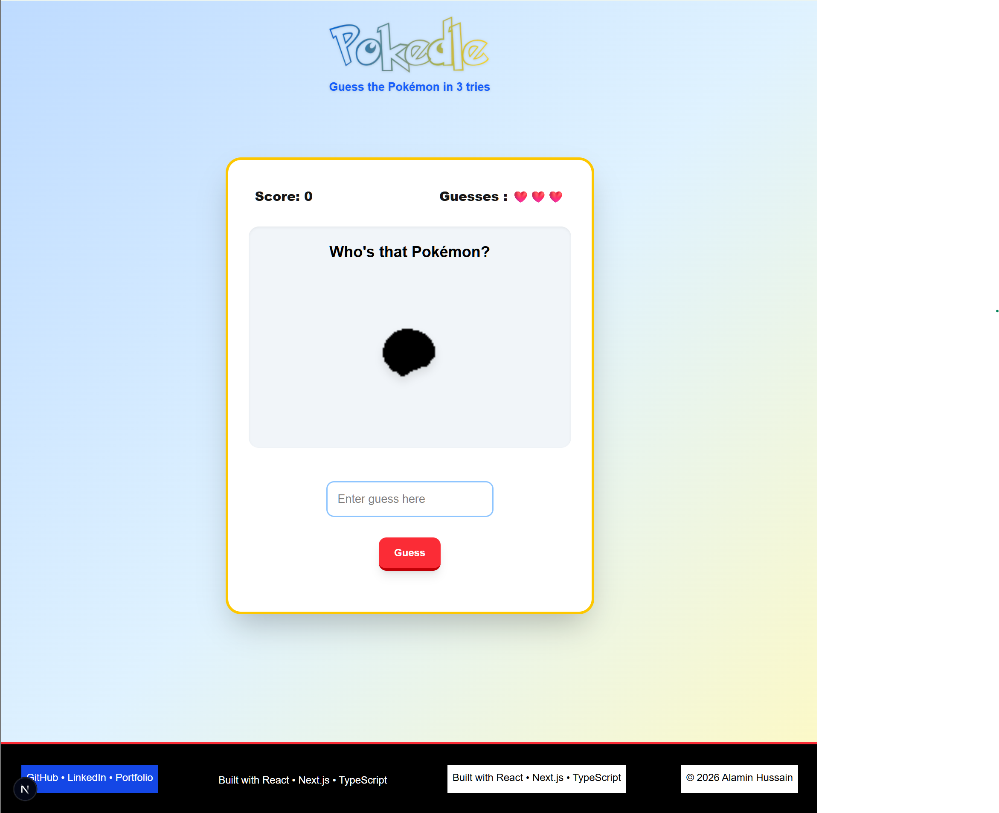

# 🎮 Pokédle
An interactive Pokémon guessing game built with **Next.js**, **React**, **TypeScript**, and **Tailwind CSS**. 

Guess the hidden Pokémon in three attempts by identifying its silhouette. Build your score by maintaining a streak and see how high you can get. The highest score goes on the podium of Pokemon Master!

🔗 **Live Demo:** https://silhouette-safari.vercel.app/

## Gameplay



### Tech Stack

- React
- Next.js
- TypeScript
- Tailwind CSS

### APIs

- PokeAPI

### Development Tools

- Git
- GitHub
- Visual Studio Code

## Features (WIP)

- [x] Integrated to PokeAPI
- [x] Implemented Scorestreak
- [] Persistent player statistics
- [x] Context API
- [] Authentication
- [] Custom React Hooks

## 🛠️ Installation

Clone the repository

```bash
git clone https://github.com/hussainalamin701/pokemon-guesser.git
```

Move into the project

```bash
cd pokemon-guesser
```

Install dependencies

```bash
npm install
```

Start the development server

```bash
npm run dev
```

Open

```
http://localhost:3000
```

---

## 🌐 API

This project uses the free PokéAPI.

https://pokeapi.co/

---

## 👨‍💻 Author

**Alamin Hussain**

GitHub:
https://github.com/hussainalamin701

LinkedIn:
https://www.linkedin.com/in/alamin-hussain-740783285/

---